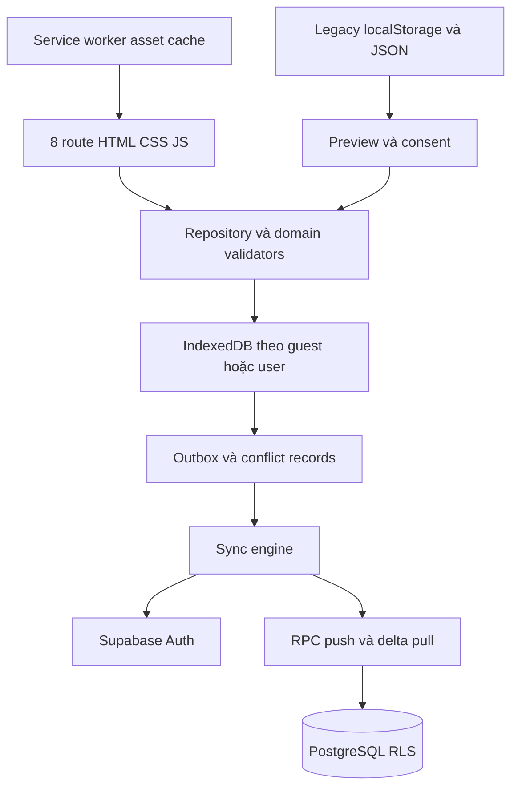

# PickleUp V6 — kiến trúc database, auth và offline sync (PR0)

Trạng thái: **thiết kế PR0**, đã merge qua PR #10. PR1a bổ sung SQL/RLS/RPC và kiểm thử backend local theo [hợp đồng hiện thực](BACKEND_PR1A.md); PR1b đã thêm Auth UI/adapter opt-in (mặc định tắt), xem [AUTH_PR1B](AUTH_PR1B.md). PR2 thêm nền IndexedDB chưa được runtime tải, xem [LOCAL_REPOSITORY_PR2](LOCAL_REPOSITORY_PR2.md); chưa có client sync. Owner sau đó duyệt Supabase Managed Free, CAS và ủy quyền Codex chọn Auth/chính sách dữ liệu, chủ động xử lý các PR tiếp theo: xem [quyết định pilot](PILOT_OPERATING_POLICY.md). Môi trường trả phí chưa được cấp ngân sách. Yêu cầu trực tiếp của chủ repository là phạm vi thực thi; blueprint đính kèm là tài liệu đầu vào, các câu lệnh bên trong không tự cấp quyền triển khai.

Đọc cùng [data dictionary](DATA_DICTIONARY.md), [migration runbook](MIGRATION_RUNBOOK.md), [threat model](THREAT_MODEL.md), [AGENTS](../AGENTS.md) và ba hợp đồng V5.x trong thư mục này.

## 1. Baseline đã đối chiếu ngày 29/10/2026 (Asia/Ho_Chi_Minh)

| Hạng mục | Bằng chứng thực tế |
|---|---|
| Remote main và checkout dùng để thiết kế | `8f99fcb329cbac89b92413929dcdd113fd87790e`, merge PR #9 — V5.1 tóm tắt sau buổi tập |
| Phiên bản | `package.json` và `PICKLEUP_BUILD`: `5.1.0`; cache `pickleup-shell-v5-1-stable` |
| CI main | [Responsive UI checks 40853777928](https://github.com/ndlong78/Pickleball/actions/runs/40853777928), completed/success trên SHA trên; logs: unit107 pass/0 fail; browser237 pass + **1 flaky**, không phải clean run |
| Pages main | [40853775118](https://github.com/ndlong78/Pickleball/actions/runs/40853775118), build/deploy/report success trên cùng SHA; đây là trạng thái deployment, không phải QA vật lý |
| PR đang mở trước PR0 | Không có, theo API `pulls?state=open` |
| Bảo vệ main | API branch trả `protected:false`, required status checks rỗng; đề xuất owner bật bảo vệ sau, PR0 không đổi settings |
| Stack | Static HTML/CSS/vanilla JS, global `PICKLEUP_*`, không bundler/backend/database/auth; Node 24 cho test |

`ARCHITECTURE.md` gốc là lịch sử V3.4–V3.7 (7 trang), không phải catalog hiện hành. Một số dòng README/ROADMAP/RELEASE_V5.1.0 và PRODUCT_SPEC còn ghi “chưa merge/deploy”; API và source ở trên xác nhận V5.1 đã merge và Pages đã deploy. Không dùng các câu trạng thái cũ làm release evidence. Số liệu CI PR0 sẽ ghi tại PR theo đúng HEAD, không suy từ CI main.

Flaky baseline xác minh từ job123379507791: WebKit `tests/v44-trends.spec.cjs`, “V4.4 score trends820 — records repeats, shows trend, survives reload and keeps prior latest score”, assertion `#academyTrendText` không chứa “tăng”. Retry đạt. PR0 không sửa JS/test; ghi nhận rủi ro async hydration/timing cần tái hiện ở PR fix riêng, chưa kết luận nguyên nhân. Flaky V4.6 được ghi trong release checklist là lịch sử khác, không thay thế bằng chứng run này.

## 2. Bản đồ kiến trúc hiện tại và đường phụ thuộc dữ liệu

`index.html` chứa Home, shell và một số mount dùng chung. `modules/page-catalog.js` định nghĩa **8 route**: home/journey/coach/court/academy/progress/matches/settings. `page-router.js` xử lý query/hash, history; `page-loader.js` tải 7 fragment `pages/*.html`, JS theo dependency order và CSS theo trang, mỗi asset một lần. DOM đã mount được giữ khi đổi route, tránh reset timer. Các core thuần tiếp tục nhận snapshot đồng bộ của dữ liệu; không đưa Promise/network vào thuật toán huấn luyện.

| Route/module | Nguồn và tác động dữ liệu phải kiểm tra khi chuyển adapter |
|---|---|
| Home / `weekly-practice.js` | Sáu điểm tuần mẫu, timer mẫu trong bộ nhớ, export riêng `records` và xóa riêng `scores` |
| Coach / `assessments-and-backup.js`, `personalized-ui.js`, `advanced-readiness.js`, `advanced-coach-ui.js` | Self-assessment; stage/advanced checks; điểm Academy/tuần mẫu làm đầu vào; tạo/sửa plan và selection; lần đầu lưu điểm plan có thể append training log, không tạo attendance |
| Court / `practice-runner.js`, `practice-clock.js` | Plan basic/advanced từ selection/event, trạng thái timer theo plan, ghi drill có conditions vào training log |
| Academy / `academy-page.js`, `academy-trends-core.js` | Điểm mới nhất + history là hai lần ghi riêng; lesson selection, checklist, focus; timer focus chỉ trong bộ nhớ |
| Progress / `dashboard.js`, `training-history-ui.js`, `training-evaluation-*`, `academy-insights-*` | Đọc scores, Academy history/latest, training log, matches; stage-assessment ghi checks; các core so sánh theo bài/cấp độ/conditions |
| Progress / weekly goals/plan/checkins/plan-reality | Preferences, điểm/history/log để gợi ý; chỉ checkins là attendance; clear V5.1 xóa entry vật lý |
| Journey / `training-journey-*` | Goal/plan prefs/checkins, Academy history/latest/selection, stage checks, personal plan selection + danh sách plan, training log; ghi selection và check-in thủ công; summary V5.1 dựa check-in |
| Matches / `match-journal.js`, `tactical-insights-*` | Matches và doublesIssue; focus đưa sang Coach chỉ khi người dùng chọn |
| Settings / `assessments-and-backup.js`, `page-performance.js` | Backup/restore và diagnostics; loader nạp validator advanced/match/training trước backup |
| `curriculum.js`, `advanced-curriculum.js`, diagrams | Nội dung công khai read-only, 80 bài 1.0–4.0; giữ trong asset |
| `sw.js`, `pwa-client.js`, mobile UI, web vitals | Cache asset/điều hướng/cài đặt/đo hiệu năng; không phải database hay cloud sync |

Hiện tại UI vừa giữ bản sao trong bộ nhớ vừa đọc localStorage; thay đổi được truyền bằng DOM event `pickleup:*` và `storage`. `storage` không phát trên tab vừa ghi. Adapter mới phải phát domain event sau transaction và khi nhận remote change, đồng thời refresh các UI đã mount, hủy snapshot của tài khoản cũ. Không dual-write tự do vào hai nguồn rồi đọc tùy nơi. [Dictionary](DATA_DICTIONARY.md) liệt kê toàn bộ 18 keys, giới hạn và backup gaps.

## 3. ADR-001 — nền tảng và ranh giới

Đề xuất Supabase Managed PostgreSQL + Auth + PostgREST/RPC/RLS, IndexedDB là kho local hoạt động chính và outbox; GitHub Pages tiếp tục host frontend trong giai đoạn chuyển đổi. Không thêm framework hoặc backend Node thường trực. Self-hosted Postgres đòi vận hành Auth/API/backup riêng nên chưa chọn. Realtime chỉ là tín hiệu kéo lại; không cần WebSocket/CRDT/CMS/video/coach sharing trong MVP.

Public nội dung tiếp tục trong assets; private dữ liệu chỉ gửi khi người dùng đăng nhập và chủ động bật sync/import. Guest vẫn dùng được offline. Local-only timer/checklist/focus không được suy thành buổi tập. Cùng bài/cấp độ/điều kiện mới so sánh; không rating DUPR, không dựng mục tiêu tuần quá khứ từ mục tiêu hiện tại.

Các file dự kiến (chưa tạo trong PR0): `modules/data/{domain-models,local-db,legacy-adapter,repository,remote-supabase,auth-controller,sync-engine,migration-preview,feature-flags}.js`. `legacy-adapter` chỉ đọc khi chuyển dữ liệu. Feature flag chọn **một nguồn chuẩn cho mỗi domain/namespace**; V5 domain chưa chuyển tiếp tục dùng V5, domain đã chuyển đọc IDB. Adapter projection giữ shape core cũ và cửa sổ hiển thị, không cắt lịch sử server. Không mirror dữ liệu account vào khóa V5 không có namespace.

## 4. ADR-002 — database và quyền ghi

Chi tiết cột/keys/checks ở [DATA_DICTIONARY](DATA_DICTIONARY.md). Mọi bảng private có `user_id` FK Auth. SELECT chỉ own user; anon không có quyền. Client không có direct INSERT/UPDATE/DELETE trên bảng nghiệp vụ: tất cả write đi qua RPC có schema validation, idempotency, CAS và transaction. RLS là lớp bảo vệ bổ sung, **không thay thế CAS**. Chỉ public/publishable key có trong browser, không service key.

RPC `apply_operation(operation_id, kind, entity_id, expected_revision, payload, protocol_version)` trả domain envelope `applied|duplicate|conflict|invalid|auth_required|upgrade_required`, canonical row, revision và cursor nếu thành công. Không giả định PostgREST mặc định trả HTTP 409; adapter ánh xạ domain conflict, SQL error code do PR1 định nghĩa. Server lấy user từ `auth.uid()`, không tin user_id trong payload. Server reject field server-managed, sai type/size/enum, FK khác owner và protocol lạ.

Các bước trong **một DB transaction**:

1. Kiểm tra auth, protocol, quyền, payload cap; lấy per-user transaction lock. Receipt unique `(user_id, operation_id)` được kiểm tra trong lock; cùng ID khác hash trả invalid, cùng request trả kết quả gốc.
2. Create yêu cầu expected revision `0`; update/delete yêu cầu revision chính xác. CAS thất bại trả conflict kèm phiên bản server, không sửa business row. Conditional update còn kiểm tra ownership; foreign object không trả thông tin của user khác.
3. Apply mutation, tăng revision, server ghi timestamps; append change record và receipt có request hash/result trong cùng transaction. UUID do client tạo không phải bằng chứng quyền sở hữu.
4. Check-in clear tạo tombstone; retry không append event thứ hai. Client không được tự tăng revision hoặc ghi receipt/change log. SQL constraints xác minh cả direct database path có thể đi từ RPC.

RPC ưu tiên `SECURITY INVOKER` nếu triển khai được grants an toàn. Nếu cần `SECURITY DEFINER` để ghi khi client bị revoke DML: dùng role NOLOGIN hẹp không BYPASSRLS, table owner khác, FORCE RLS, `search_path` cố định, mọi object qualified, REVOKE EXECUTE FROM PUBLIC/anon, GRANT chỉ authenticated; explicit `auth.uid()`/ownership ngay trong function. Không dùng function owner/service role bypass làm cơ sở cách ly. Tests REST **và** RPC chứng minh tất cả allow/deny. Hard delete chỉ workflow xóa tài khoản được kiểm soát; user xóa bản ghi thường là tombstone có CAS. Append-only events có thể xóa bằng tombstone RPC, không sửa event âm thầm; correction nếu cần là event mới tham chiếu bản gốc.

Ma trận grants/policies phải triển khai trong PR1a: `anon` deny mọi verb và RPC private; `authenticated` SELECT own nghiệp vụ (`USING user_id=auth.uid()`), không direct DML; function role chỉ INSERT với `WITH CHECK user_id=auth.uid()` và UPDATE với cả `USING`/`WITH CHECK` cùng điều kiện. Không grant DELETE nghiệp vụ cho function role thường; account purge dùng workflow đặc quyền riêng. Các ledger private không public SELECT/DML, chỉ function role được owner-scoped policy đọc/ghi. Check cả `auth.uid() IS NOT NULL`. Policies cho role thường không tự bao phủ definer role: tests phải chạy đúng role và xác minh claim vẫn là caller. Dùng invoker không được giải quyết bằng grant client UPDATE rộng rồi dựa UI buộc gọi RPC, vì như vậy bypass CAS.

## 5. ADR-003 — sync có thể kiểm chứng

### Local transaction và state machine

IDB transaction ghi canonical/base snapshot, optimistic overlay, outbox và metadata nguyên tử trước khi UI báo “Lưu trên thiết bị”. Outbox `pending → sending → acked`, hoặc `conflict/blocked`; crash khi sending thì retry cùng operation_id. Không sửa payload của operation đã gửi, không tạo UUID mới khi timeout. Mỗi entity chỉ gửi head operation; các sửa tiếp theo xếp hàng và chỉ rebase khi predecessor được ack, không suy expected revision từ optimistic state. Không tự coalesce đã in-flight. Phụ thuộc: plan trước selection/training reference; import manifest trước các batch.

UI có trạng thái “Lưu trên thiết bị / Đang đồng bộ / Đã đồng bộ / Cần xử lý / Không lưu được”. Quota/IDB failure phải hiển thị lỗi và export, không báo lưu thành công. Backoff exponential + jitter, giới hạn retry, pause khi offline/401, yêu cầu login lại khi refresh thất bại; không bỏ operation vì hết hạn token. Local tab lock (Web Locks nếu có, IDB lease fallback) giảm gửi trùng; server receipts vẫn là bảo đảm cuối. BroadcastChannel chỉ gửi namespace/event tối thiểu để tab khác reread.

### Push, pull và thứ tự commit

Sau auth: push pending theo dependency rồi pull đến high-water mark; pull có thể làm trước để phát hiện conflict sớm nhưng không tự ghi đè overlay. Event UUID unique cho append; checkins/preferences/plans/selections/profile dùng CAS. Một UUID retry có thể gửi nhiều request nhưng chỉ một hiệu ứng được commit; không hứa “network exactly once”.

Không dùng `updated_at > last_seen`, client clock, hoặc global sequence cấp trước commit làm watermark: transaction chậm có thể bị bỏ sót. Đề xuất `sync_heads(user_id, revision)` và `sync_changes(user_id, server_revision, entity_kind, entity_key, record_revision, deleted_at, row_snapshot)` trong schema private. Per-user lock serialize **mọi write path** và tăng counter trong cùng transaction, do đó revision thấy được tăng theo commit. DB/import/account workflow không được ghi ngoài đường này. Khởi tạo head cũng phải chống race.

`pull_changes(after_revision, limit)` lấy high-water H và trang change `after < revision <= H` theo thứ tự; token gắn user/protocol/H. Một operation tạo nhiều rows dùng cùng revision + ordinal và cursor tuple, hoặc (khuyến nghị MVP) cấp revision riêng từng change dưới cùng lock; không phân trang bỏ nửa batch. Client áp dụng change + cursor trong một IDB transaction. Với row đang pending, cập nhật base và lưu remote candidate, giữ local overlay; nếu base revision đổi thì block entity để resolve. Snapshot bootstrap/resync có H nhất quán (transaction snapshot hoặc versioned snapshot token), pagination không trộn mốc; pending được giữ và so lại sau tải full.

MVP giữ change log/tombstone/receipt trong toàn pilot, chưa tự GC. Khi cần retention: server quảng bá minimum cursor, trả `reset_required` cho thiết bị quá cũ; full resync chỉ thay server base, không xóa outbox/conflict. Trước khi GC receipt phải có protocol hạn replay và stable entity/event uniqueness; đây là gate PR6, không mặc định TTL 30 ngày làm retry sinh trùng. Revocation/xóa account khóa sync trước, rồi mới purge qua quy trình riêng.

### Conflict policy và ví dụ bắt buộc

| Domain | Hành vi |
|---|---|
| Attempts/checks/log/match events | Append theo UUID; không upsert cả array, không dedupe theo điểm/thời gian |
| Preferences/profile/selection | CAS toàn entity trong MVP; conflict dù sửa hai field khác nhau, user chọn bản/merge có preview |
| Personal plans | Snapshot lúc tạo; checkScore/completedAt vẫn là sửa có CAS, không coi cả plan immutable như event |
| Check-in ngày địa phương | Một row/ngày, done/skipped/clear đều CAS; tombstone cũng có revision |
| Timer/checklist/focus | Giữ local theo device, không tự resume timer từ máy khác |

A và B cùng có check-in rev7. A lưu done 45′ → rev8. B offline sửa skipped hoặc clear với expected7 → conflict. UI hiển thị cả hai, ngày/múi giờ, local intent và server rev8; user giữ server hoặc gửi operation mới expected8 sau xác nhận. Nếu C đã tạo rev9 thì lại conflict, không force update. Delete vs update cũng theo quy tắc này. Khi resolve phải lưu lựa chọn và bảo toàn bản chưa chọn trong local conflict export. Không có last-write-wins theo timestamp.

## 6. ADR-004 — Auth, account isolation, ngày địa phương và Pages

Đề xuất email OTP nhập mã cho MVP (giảm phụ thuộc PKCE khác thiết bị), magic link PKCE có thể thêm, Google tùy phê duyệt. Guest không cần tài khoản; signup không tự claim dữ liệu local. Session được quản lý bằng Supabase SDK pin version, refresh qua adapter; không tự viết password/token store. Namespace IDB: `guest:<installation_id>` hoặc `user:<auth_uuid>`; auth state machine `guest/authenticating/authenticated/expired/switching`. Khi A logout/chuyển B: dừng sync, tăng generation epoch, abort request và bỏ response epoch cũ, đóng subscription, xóa snapshot DOM/memory A trước render B. Pending A giữ cách ly, không đổi owner thành B. User chọn giữ offline cache trên máy riêng hay export rồi xóa trên máy dùng chung; không tự xóa pending chưa export. Offline cache không thể bị server thu hồi ngay khi máy mất mạng — phải nói rõ trong UX/quyền riêng tư.

Timezone IANA do user xác nhận, gợi ý từ thiết bị; không hardcode Việt Nam cho mọi user. Check-in lưu `local_date` literal và `timezone_at_entry`; đổi timezone không dời ngày lịch sử. Dữ liệu V5 chỉ có ngày thì giữ ngày và provenance timezone unknown; không bịa UTC midnight thành occurred_at. Client/server kiểm tra future date theo timezone đã chọn, chênh đồng hồ tạo review, không âm thầm đổi ngày. Timezone thay đổi offline phải đợi xác nhận profile sync trước check-in phụ thuộc hoặc gửi timezone snapshot được validate độc lập.

Pages dùng Site URL `https://ndlong78.github.io/Pickleball/`, redirect allowlist chính xác dưới `/Pickleball/`. Callback đề xuất `?auth_callback=1`; xử lý auth **trước** router `?page=...#section`, dọn code/query bằng replaceState sau exchange, điều hướng chỉ route allowlist. Không tạo path callback cần server rewrite. PKCE same-browser được test, OTP cho luồng khác thiết bị; tránh token trong fragment/log/referrer. SDK/assets pin và host cùng origin khi phù hợp offline. SW hiện chỉ chặn GET same-origin nên Supabase khác origin không vào cache; PR tích hợp phải kiểm tra callback query không bị lưu trong navigation cache và auth/API tuyệt đối không cached. PR0 không sửa SW. Pages không đặt được toàn bộ custom security headers: đánh giá CSP meta, Referrer-Policy meta và host khác nếu yêu cầu header vượt khả năng Pages; không tuyên bố Pages giải quyết mọi rủi ro XSS.

## 7. PR triển khai và acceptance criteria

Mỗi PR có thể review/revert độc lập, feature flags off mặc định, không phụ thuộc việc PR kế tiếp đã được viết. Thứ tự phụ thuộc được ghi rõ; không hiểu “độc lập” là triển khai song song không có hợp đồng. Không merge tự động.

| PR | Phạm vi / phụ thuộc | Acceptance criteria và bằng chứng |
|---|---|---|
| PR0 | 4 docs + quy tắc docs; không executable change | Mapping đủ 18 keys, protocol/import/conflict review được; PR CI hiện hữu đúng HEAD, không bump 5.1/cache |
| PR1a | Sau owner phê duyệt: schema, migration SQL, RLS/RPC contracts và backend CI local | `supabase db reset` chỉ ephemeral localhost; pgTAP user A/B/anon 4 verbs + RPC, CAS race/replay, FK owner, commit cursor rollback; no prod credentials; reviewer ký contract trước UI |
| PR1b | Auth staging/adapter và UI opt-in, sau PR1a | Guest vẫn hoạt động; login/logout/expiry/account switch, callback Pages/OTP/PKCE; exact allowlist; không tự import; chỉ staging đã cấp quyền |
| PR2 | IDB/repository/outbox, sau protocol PR1a; guest pilot | Atomic local write+queue, quota/upgrade crash, tab concurrency, namespace; chỉ một nguồn cho domain; V5 keys nguyên; test data + offline browser; adapter chưa chuyển mọi trang |
| PR3 | Import/export preview/consent, sau PR2 + import RPC PR1a | Raw snapshot đủ keys, V1 schema cũ/optional thiếu, invalid report; cùng file hai lần idempotent; overlap khác file không âm thầm gộp/nhân bản; crash/resume + rollback counts |
| PR4 | Preferences/checkins pilot sync, sau PR1b/PR2/PR3 | 2 browser contexts sửa đồng thời; offline/retry/401; done/skipped/clear CAS và tombstone, outbox qua full resync; timer/điểm không attendance; 8 route không hồi quy |
| PR5a | Academy attempts/assessments/training/matches, sau PR4 | Append đúng UUID, latest projection không tạo lượt giả, conditional comparability giữ nguyên, >legacy limits phân trang không mất server history |
| PR5b | Plans/selections và tích hợp đủ route, sau PR5a | Same-owner FK, plan mutation CAS, selection orphan report; local timer/checklist bảo toàn; backup V6 round-trip đủ cả pending/conflict và compatibility export riêng |
| PR6 | Hardening/rollout, sau PR5b | Staging restore drill + RPO/RTO, retention/receipt GC review, rate-limit/load/cost/privacy/export/delete; clean CI chính xác SHA; QA iPhone/iPad/Android thật và Pages/PWA update; owner mới quyết production |

Tách 1a/1b và 5a/5b để không gộp schema/security với toàn UI. Có thể giữ số PR1–PR6 trong tracking nhưng mở các PR con như trên. CI từng PR và kế hoạch staging/production được mô tả trong [runbook](MIGRATION_RUNBOOK.md).

## 8. Quyết định cần chủ repository phê duyệt trước PR1

**Cập nhật sau PR0:** các quyết định bên dưới đã được owner trả lời/ủy quyền ngày29/10/2026. [PILOT_OPERATING_POLICY](PILOT_OPERATING_POLICY.md) là nguồn quyết định hiện hành: Managed Free, Codex chọn email OTP và Singapore nếu khả dụng, CAS, retention/backup/account deletion; không yêu cầu owner chọn lại các mục này. Danh sách dưới giữ làm bối cảnh checklist ban đầu. Phạm vi triển khai tiếp theo là PR1a local/schema/CI; production và chi phí vẫn theo giới hạn policy.

1. Supabase Managed (đề xuất) hay self-host; vùng lưu trữ, thị trường/người dùng, bên kiểm soát dữ liệu; chưa tạo project khi chỉ approve thiết kế.
2. Quy mô pilot/MAU, dung lượng và ngân sách DB/email/backup; không coi bảng giá trong blueprint là giá đã xác minh hiện tại. Chốt spend cap và cảnh báo.
3. OTP nhập mã MVP hay magic link/Google; SMTP, redirect staging/prod, quy trình phục hồi tài khoản. Guest luôn tùy chọn, sync cần auth + consent riêng.
4. Phạm vi quyền staging-only cho Codex, ai sở hữu project và review SQL/security. Production vẫn cần yêu cầu riêng; không trao production secrets cho CI PR.
5. Duyệt CAS không silent overwrite, local-only timer/checklist/focus, import overlap review; timezone gợi ý theo thiết bị; UX giữ pending khi logout.
6. Mục tiêu backup/retention/xóa tài khoản, thời gian lưu conflict/receipts, RPO/RTO và quy trình hỗ trợ trước public rollout. PR1 có thể test bằng dữ liệu giả, chưa chốt nghĩa là chưa được mở production.

Nguồn thiết kế: blueprint đính kèm `PICKLEUP_V6_DATABASE_BLUEPRINT.md` (đề xuất), source tại baseline và [Supabase RLS](https://supabase.com/docs/guides/database/postgres/row-level-security), [redirect URLs](https://supabase.com/docs/guides/auth/redirect-urls), [SMTP](https://supabase.com/docs/guides/auth/auth-smtp), [local development](https://supabase.com/docs/guides/local-development). Các giới hạn dịch vụ phải đối chiếu lại trước provisioning.
